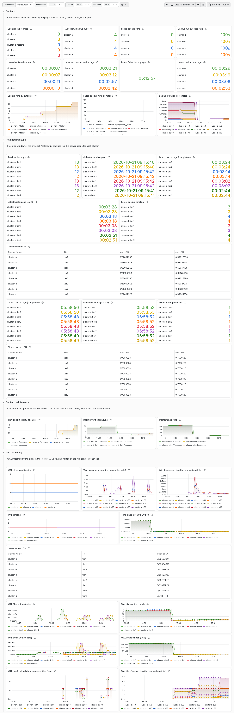
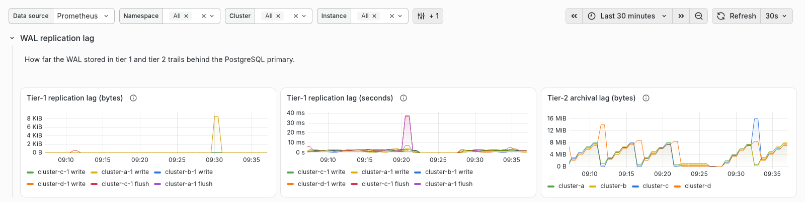
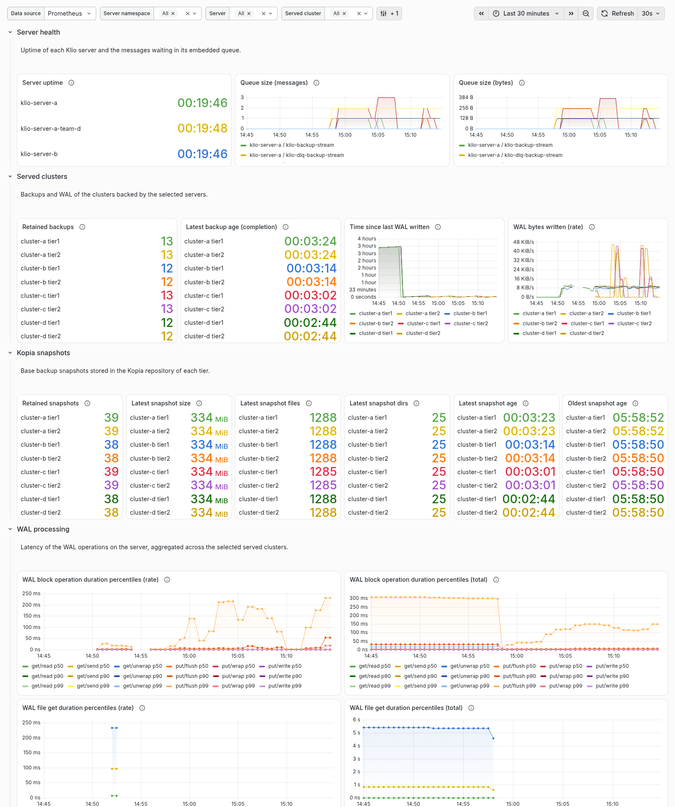

# Grafana Dashboards

Klio ships a Grafana dashboard template that visualizes the metrics it
exposes. The dashboard is generated from code with the
[Grafana Foundation SDK](https://github.com/grafana/grafana-foundation-sdk)
and committed to the repository at
`observability/grafana/dashboards/klio.json`.

The dashboard has two sections, each with its own filters that apply to all
of its panels:

- **Clusters**, organized around the PostgreSQL clusters that Klio backs up.
- **Servers**, organized around the Klio servers.

The dashboard queries the Prometheus export of Klio's OpenTelemetry metrics,
so it complements the [OpenTelemetry](opentelemetry.md) setup rather than
replacing it.

## What the dashboard shows

The **Clusters** section is split into rows:

- **Backups** — the backup lifecycle as seen by the plugin sidecar
  running in each PostgreSQL pod: backups in progress, time since the last
  backup started, succeeded and failed, the latest backup duration, the
  p50/p90/p99 backup duration distribution, backup run and failure rates,
  and the backup success ratio.

- **Retained backups** — the retention window of the physical PostgreSQL
  backups the Klio server keeps for each cluster: counts by tier and server,
  latest/oldest backup age, start/end LSN and PostgreSQL timeline.
- **Backup maintenance** — tier-2 relay, backup verification and
  maintenance run totals per cluster.
- **WAL archiving** — the WAL streaming client the sidecar supervises as a
  child process (the PostgreSQL timeline it is currently streaming and the
  p50/p90/p99 latency of sending a WAL block to the server), and the WAL the
  server writes: throughput and freshness per tier, the latest written LSN
  and the p50/p90/p99 tier-2 upload duration.


- **WAL replication lag** — how far behind Klio is in copying WAL:
  - **Tier-1 replication lag (bytes)** and **(seconds)**: how much WAL,
    and how much time, Klio is behind the PostgreSQL primary. The *write*
    line is WAL Klio has received; the *flush* line is WAL Klio has
    safely saved to disk. These two panels need CloudNativePG monitoring
    (see the prerequisites below).
  - **Tier-2 archival lag (bytes)**: how much WAL is on Klio's local disk
    (tier 1) but not yet copied to remote storage (tier 2).



- **WAL restore** — the WAL restores the plugin serves back to PostgreSQL,
  per instance (pod), since each instance restores its own WAL through its
  own prefetch spool: the p50/p90/p99 restore duration (how long PostgreSQL
  waited for each WAL file, not the replay that follows), as both a
  rolling-window and a since-restart total variant, the restore rate and
  total by tier and outcome, the prefetch hit ratio, and the share of time
  PostgreSQL spent waiting on the plugin (near 0% when recovery is limited
  by replay, not by Klio).

The **Servers** section is split into rows:

- **Server health** — the uptime of each Klio server and its embedded NATS
  JetStream queue.
- **Served clusters** — retained backups, latest backup age, time since the
  last WAL written and WAL throughput of the clusters backed by the selected
  servers.
- **Kopia snapshots** — the base snapshot inventory, including file and
  directory counts.
- **WAL processing** — p50/p90/p99 WAL block and get duration by path, stage
  and tier, each as both a rolling-window and a since-restart total variant.



Some panels need extra context to interpret correctly. Two are derived
from the alerting guidance in [OpenTelemetry](opentelemetry.md):

- **Time since last WAL written** surfaces the staleness signal
  described under *Alerting on stalled WAL processing*: a stale tier-1 value
  means PostgreSQL is no longer shipping WALs, while a stale tier-2 value
  means the remote backend is no longer receiving them.
- **Tier-2 archival lag (bytes)** plots the LSN difference between
  tier 1 (local disk) and tier 2 (remote storage). Read together with the
  staleness panel, it tells a slow pipeline (timestamps advancing, gap
  growing) apart from a stalled one (timestamps and LSN both frozen).

One more is a statistical caveat rather than an alerting signal:

- **WAL restore duration percentiles** pool prefetch hits, a local rename,
  and misses, a wait on a download, which are orders of magnitude apart. With
  a high hit ratio the lower percentiles describe hits, around a
  millisecond, and misses only show in the upper percentiles. Read them
  together with the **WAL restore prefetch hit ratio**, whose fall over time
  means prefetch is no longer keeping up with replay on that instance, and
  the **WAL restore wait share**, which shows how much the waiting costs.

## Prerequisites

The dashboard needs Grafana 13.1 or later. It uses the dashboard schema v2
(dynamic dashboards), where each section declares its own variables. Any of
these provides it:

- The [kube-prometheus-stack](https://github.com/prometheus-community/helm-charts/tree/main/charts/kube-prometheus-stack)
  chart, whose current releases install Grafana 13.2 (see the example
  below).
- The [Grafana Helm chart](https://github.com/grafana/helm-charts/tree/main/charts/grafana),
  setting `image.tag` to 13.1 or later if the chart default is older.
- The `grafana/grafana` container image, tag 13.1 or later.
- Grafana Cloud.

The dashboard reads the Prometheus names of Klio's metrics (for example
`klio_plugin_backup_runs_total` and `klio_server_wal_written_total`). You
therefore need Prometheus scraping those metrics. Any of the export paths
described in [OpenTelemetry](opentelemetry.md) works:

- An OpenTelemetry Collector with a Prometheus exporter that Prometheus
  scrapes.
- The Klio Prometheus exporter (`OTEL_METRICS_EXPORTER=prometheus`),
  scraped directly.

The **WAL replication lag** row of the Clusters section additionally reads
CloudNativePG's `cnpg_pg_stat_replication_*` metrics. To populate it,
scrape the CloudNativePG cluster monitoring (its `PodMonitor`) into the same
Prometheus. The rest of the dashboard works without it.

:::note
When you route metrics through an OpenTelemetry Collector, enable
`resource_to_telemetry_conversion` on the Prometheus exporter so that
resource attributes such as the pod and namespace become Prometheus labels.
The sample collector under
`operator/config/samples/opentelemetry/base/otel_collector.yaml` already does
this.
:::

## Importing the dashboard

The dashboard file is a Grafana resource (`dashboard.grafana.app/v2`, named
`klio`), the format Grafana uses for schema v2 dashboards.

1. In Grafana, go to **Dashboards → New → Import**.
1. Paste the contents of `observability/grafana/dashboards/klio.json` and
   select **Load**.
1. Select your Prometheus data source for the `datasource` variable.

The dashboard declares a `datasource` variable, so it is portable across
Grafana installations and is not tied to a specific data source UID. The
variables of each section filter its panels.

On the Clusters section:

- `namespace`: the namespace where the PostgreSQL cluster runs, matched
  against `k8s.namespace.name`.
- `cluster`: the PostgreSQL cluster, matched against `cluster_name`. It
  lists every cluster that emits Klio plugin metrics, including clusters
  that only restore from a Klio server.
- `pod` (*Instance*): the PostgreSQL pod, matched against `k8s.pod.name`.
  It scopes the panels built from the plugin metrics and the WAL
  replication lag panels, which CloudNativePG reports from the primary.

The server-side metrics carry the server's own namespace and pod, not the
cluster's, so the server panels apply `namespace` and `pod` through the
plugin metrics: they show the clusters whose plugin reports metrics for the
selected namespaces and instances. A cluster that no longer reports plugin
metrics, for example because it was deleted, does not appear in them.

On the Servers section:

- `server_namespace` (*Server namespace*): the namespace where the Klio
  server runs, which can differ from the namespace of the clusters it backs
  up.
- `server`: the name of the Klio `Server`, taken from its pod name
  (`<server>-klio-<ordinal>`). A server is identified by its namespace and
  name: with *Server namespace* set to all, two servers with the same name in
  different namespaces share one entry, so select the namespace to tell them
  apart.
- `served_cluster` (*Served cluster*): the clusters backed up by the
  selected servers, from any namespace. On the server health panels, which
  have no cluster label, it keeps the servers that back the selected
  clusters.

Every aggregation groups by the identifying label (cluster, server, tier),
so multiple clusters or servers are never folded into a single misleading
value.

### Example: kube-prometheus-stack

This example follows the same flow as the
[CloudNativePG quickstart](https://cloudnative-pg.io/docs/current/quickstart/#grafana-dashboard),
using the
[kube-prometheus-stack](https://github.com/prometheus-community/helm-charts/tree/main/charts/kube-prometheus-stack)
chart. Adapt it to your own Prometheus/Grafana if you run a different setup —
only the metric prerequisites described above are required.

Install Prometheus and Grafana:

```sh
helm repo add prometheus-community \
  https://prometheus-community.github.io/helm-charts
helm upgrade --install \
  -f https://raw.githubusercontent.com/cloudnative-pg/cloudnative-pg/main/docs/src/samples/monitoring/kube-stack-config.yaml \
  prometheus-community prometheus-community/kube-prometheus-stack
```

Ensure Prometheus scrapes Klio's metrics by deploying a `ServiceMonitor` (or a
`PodMonitor`, if the collector's `Service` has no labels) for the
OpenTelemetry collector's Prometheus exporter — see
`operator/config/samples/opentelemetry/base/otel_collector_svc_monitor.yaml`.

Port-forward Grafana and log in with `admin` / `prom-operator`:

```sh
kubectl port-forward svc/prometheus-community-grafana 3000:80
```

Open `http://localhost:3000/` and import
`observability/grafana/dashboards/klio.json` via **Dashboards → New →
Import**, selecting your Prometheus data source.

Alternatively, load it automatically through the Grafana dashboard sidecar
with a labeled `ConfigMap`:

```sh
kubectl create configmap klio-grafana-dashboard \
  --from-file=observability/grafana/dashboards/klio.json
kubectl label configmap klio-grafana-dashboard grafana_dashboard=1
```

Create the `ConfigMap` with `kubectl create`, as above: `kubectl apply`
stores a copy of the dashboard in an annotation, which exceeds the
Kubernetes size limit for annotations.

## Regenerating the dashboard

The committed JSON is generated from the Go program under
`observability/grafana/`. To regenerate it after changing the generator (or
after a `grafana-foundation-sdk` bump), run from the repository root:

```sh
task grafana:gen
```

CI runs `task grafana:uncommitted`, which regenerates the dashboard and
fails if the committed JSON has drifted from the generator output. Commit
the regenerated file whenever it changes.
